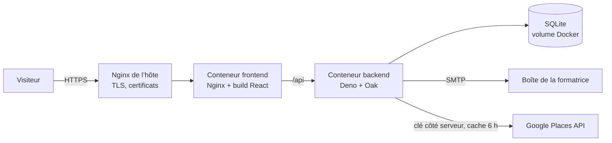
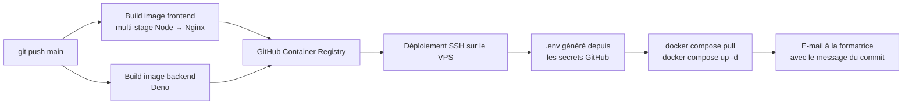

# Stage Bois Bretagne

Site de l’atelier de chantournage d’Annick Le Goasteller, à Trébrivan (Côtes-d’Armor), en ligne sur **[stageboisbretagne.com](https://www.stageboisbretagne.com)**.

Projet lancé à la fin du Master 1 pour consolider les acquis des UE Systèmes à objets répartis et Administration système, du recueil des besoins jusqu’à la mise en production sur un VPS. Il combine un frontend React/Vite et une API propulsée par Deno. Ce README présente les choix techniques retenus et le fonctionnement de la chaîne de déploiement.

---

## Le besoin

Ce site remplace l’ancien site de l’atelier, réalisé par un autre prestataire sur une version de WordPress qui n’était plus à jour. Un incident de sécurité (une redirection malveillante introduite par un plugin compromis) a accéléré la décision de refonte.

L’objectif était de reconstruire un site vitrine simple, sécurisé et facile à maintenir, avec quatre priorités :

- supprimer la surface d’attaque liée à WordPress ;
- permettre à la propriétaire de mettre à jour la date du prochain stage sans compétences techniques ;
- moderniser le design et l’ergonomie ;
- afficher la note Google et gérer les témoignages mis en avant.

Le site présente les stages (initiation, jouets en bois, perfectionnement), les formules, l’hébergement sur place et les articles de presse, et permet de s’inscrire au moyen d’un bulletin PDF. Deux contraintes ont guidé les choix techniques : l’utilisatrice de l’administration n’est pas technicienne, et le site tourne sur un petit VPS partagé avec d’autres projets.

---

## Déroulé du projet

Le projet s’est fait en quatre week-ends :

1. Recueil du besoin et rédaction du cahier des charges.
2. Configuration et sécurisation du VPS, mise en place de la chaîne CI/CD (une première) et rédaction de la documentation technique.
3. Développement du site et de l’administration.
4. Finitions et mise en ligne.

---

## Architecture



| Couche | Technologies |
|---|---|
| Frontend | React 19, TypeScript, Vite, React Router, CSS Modules, jsPDF |
| Backend | Deno 2, Oak, SQLite, Nodemailer |
| Infrastructure | Docker, Docker Compose, Nginx, GitHub Actions, GitHub Container Registry |

Les deux conteneurs n’écoutent que sur `127.0.0.1` : seul le Nginx de l’hôte, qui gère le HTTPS, est exposé sur Internet.

---

## Choix techniques

**Deux points d’entrée dans le frontend.** Vite construit deux applications distinctes, `index.html` pour le site public et `admin.html` pour l’administration. Le code de l’interface d’administration n’est donc jamais téléchargé par les visiteurs du site.

**Une administration réduite au strict nécessaire.** Pour chaque type de stage, la formatrice saisit les dates, le nombre de places et un court descriptif, puis choisit d’afficher ou non la session. Les sessions dont la date de fin est passée sont masquées automatiquement. Elle gère aussi les trois témoignages affichés sur la page d’accueil. Rien n’a été ajouté au-delà : chaque champ supplémentaire était une occasion de se tromper.

**Aucune donnée de stagiaire stockée sur le serveur.** Le bulletin d’inscription est généré en PDF dans le navigateur avec jsPDF, puis téléchargé par le stagiaire. Le backend se contente de transmettre la demande par e-mail à la formatrice. Rien n’est conservé en base, ce qui simplifie la conformité au RGPD et réduit ce qu’une éventuelle intrusion pourrait exposer.

**La note Google passe par le backend.** La note globale et le nombre d’avis sont récupérés via l’API Google Places côté serveur, puis gardés en cache six heures. La clé d’API ne quitte jamais le serveur et le quota reste négligeable.

**Deno et SQLite pour le backend.** Deno exécute TypeScript sans étape de compilation et impose de déclarer les permissions (réseau, fichiers, variables d’environnement). SQLite suffit largement pour quelques dizaines de lignes : la base vit dans un volume Docker et son schéma est créé ou mis à jour au démarrage du conteneur.

**Référencement.** Chaque page définit son titre et sa description avec `react-helmet-async`, et le site fournit un `sitemap.xml` et un `robots.txt`.

---

## Chaîne CI/CD

Chaque push sur `main` déclenche le workflow [`.github/workflows/deploy.yml`](.github/workflows/deploy.yml) :



1. **Build sur les runners GitHub.** Les images étaient d’abord construites directement sur le VPS. Cette étape a été déplacée sur GitHub Actions : le serveur ne compile plus rien et se contente de télécharger des images prêtes. L’image du frontend est construite en deux étapes, Node.js pour le build Vite, puis Nginx Alpine pour servir les fichiers statiques. L’outillage de build n’est donc pas présent dans l’image finale.
2. **Publication sur GHCR.** Les images sont poussées sur GitHub Container Registry avec le `GITHUB_TOKEN` du workflow, sans identifiant supplémentaire à gérer.
3. **Déploiement.** Le workflow copie `docker-compose.yml` sur le VPS par SCP, puis s’y connecte en SSH avec une clé dédiée au déploiement.
4. **Secrets.** Le fichier `.env` de production est généré sur le serveur à chaque déploiement, à partir des secrets GitHub, avec les droits `600`. Aucun secret n’existe dans le dépôt.
5. **Notification.** Une fois le déploiement réussi, la formatrice reçoit un e-mail qui reprend le message du commit en guise de note de version. C’est pourquoi les messages de commit décrivent ce qui change pour elle (« ajout des articles de presse », « correction de la durée et tarif du stage de jouet ») plutôt que des détails techniques.

---

## Sécurité

- Conteneurs liés à `127.0.0.1`, seul le Nginx de l’hôte est exposé.
- Secrets uniquement dans GitHub Actions, injectés au déploiement.
- Formulaires publics (contact, inscription) limités en nombre d’envois par adresse IP.
- Administration protégée par mot de passe, avec blocage temporaire après plusieurs échecs.

---

## Lancer le projet en local

Prérequis : Node.js 20 et Deno 2.

```bash
cp .env.example .env          # puis renseigner les valeurs

cd backend && deno task dev    # API sur http://localhost:8000
cd frontend && npm install && npm run dev   # site sur http://localhost:5173
```

Le serveur de développement Vite redirige `/api` vers le backend. L’administration est accessible sur `http://localhost:5173/admin.html`.
